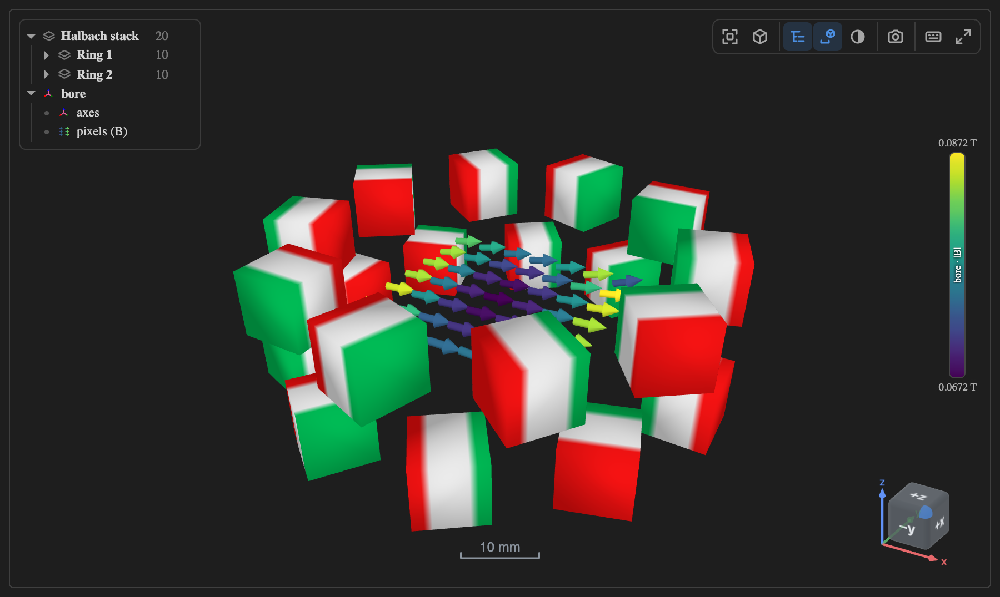
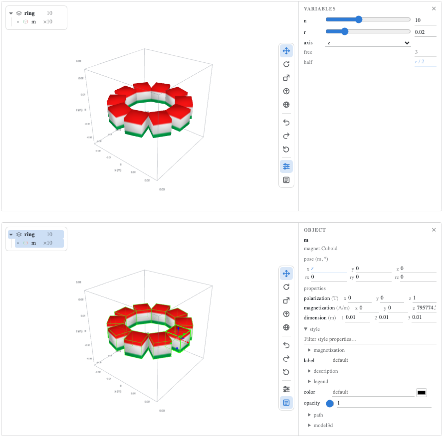

# The 3D view in a notebook

_The full guide. The short version is in the
[README](https://github.com/magpylib/magpylib-studio/blob/main/README.md#use-it-in-a-notebook)._

```sh
pip install "magpylib-studio[widget]"
```

```python
import magpylib as magpy
from magpylib_studio.widget import SceneWidget

SceneWidget(magpy.magnet.Cuboid(polarization=(0, 0, 1), dimension=(1, 1, 1)))
```

`magpy.show(objects, backend="widget")` is the same thing said magpylib's way,
and `magpy.defaults.display.backend = "widget"` makes every `show()` in the
notebook draw one. A script has no cell to draw in: run from a terminal of a
studio window, it draws in the Magpylib Studio panel, and anywhere else it opens
the view in your browser as a saved page, saying where. The tools sit in the
view's top-right corner and show when the pointer is on it, as Plotly's modebar
does: the legend, the axes, framing, the projection, the theme, a picture,
export and full screen. `animation=True` captures the paths, and a transport
along the foot of the view plays and scrubs them: in the browser, from the
motion, when every step is the first one moved — and a frame at a time from
python when the run changes shape as it goes.

`view.step` is the step on screen, the row of a field read along the path, so a
plot of what a sensor reads can mark where the run is. The view says it when the
run pauses, ends or is scrubbed, not at each frame it plays; set from a cell,
the view goes there:

```python
view = SceneWidget(magnet, sensor, animation=True)
B = sensor.getB(magnet)  # a row per step of the path

view.observe(lambda change: marker.set_xdata([change.new]), "step")
view.step = 20  # the view stops at step 20
```

In marimo, feed a `mo.state` from that observer and read it in the plot's cell;
the turning magnet's notebook does that.

The axes button goes round three ways to show the scale: a view cube with a
scale bar, which is the default, the graduated box, and none; `axes="cube"`,
`"box"` or `"none"` chooses one from code. At rest the corner shows only small
x, y and z arrows; point at them and they grow into the cube. Click a face, an
edge or a corner of the cube and the view turns to look from there. Lengths are
said in the unit that reads best: the bar beside a Halbach ring reads `10 mm`,
and the box round it is ticked in millimetres too.



A `SceneWidget` is read only, like the panel — what a view can offer to edit is
what its host can put back, and a cell has already run (for a view you can edit,
see [Editing a scene in the notebook](#editing-a-scene-in-the-notebook)).
Selecting, hiding and fading are the exceptions, because they are values rather
than edits:

```python
scene = mo.ui.anywidget(SceneWidget(height=460))  # one cell: the view
...
scene.widget.update(ring, probe)  # another: what it draws
scene.widget.picked  # a third: what was clicked
```

**Make the view once and re-point it.** A slider re-runs every cell that reads
it, so a `SceneWidget(...)` in one of them is a _new widget per drag_: a new
element, controls rebuilt from nothing, and the camera back at its opening
framing — you lose the zoom you were working in. `update()` replaces the drawn
objects and leaves the view alone, which is what makes a slider smooth. Such a
view is made with `editable="never"`: no pencil, since an edit would be lost at
the next move of a slider.

**The legend** floats over the view: the objects as they are nested, with a
caret to fold a collection, an eye to hide it and everything in it — shown on
the row under the pointer, and always on one that is hidden — a swatch in the
colour it is drawn, and the row itself to click: ⌘/ctrl adds, shift takes a
range in tree order, a double click frames it. Press the eye and slide sideways
to fade instead: left to look through it, right to bring it back. A click in the
view goes through what is faded to what is behind it. A sensor whose pixels read
the field is listed as its parts — its axes, its pixels and its field lines,
each naming the field it shows — and hides each apart; the field lines' eye is
their switch, `field_lines`. Such a sensor's colours have a colour bar down the
right edge, beside the editing column, whose two handles cut the range they span
— the colormap stretched over the cut, the field past it in the end colours —
kept in `color_range` as `{id: [low, high]}`, in SI; a click on a value types
one, a focused handle takes the arrow keys, and a picture of the view carries
the bar; `color_shared` gives the sensors on one colormap one scale. It writes
`selected`, `hidden` and `faded`, the traitlets a click in the view and a
notebook cell write too; `faded` maps an id to the share of its opacity it is
drawn at. It needs the objects, because the payload cannot say how they nest: it
comes with `SceneWidget(...)` and `update()`, and with a bare `magpy.show()`
only where magpylib hands its backends the objects (`Panel.objects`).

What is selected, hidden, faded or folded survives `update()`: an object passed
again keeps it, and a rebuilt one inherits it from whatever sat in its place in
the tree — "the lower ring" is still the one below after a slider has remade
both.

**Keys**, once the view has focus, are the panel's: **F** frames the selection
and **Home** everything, **1**/**3**/**7** look from the front, right and top,
**5** switches the projection, **H** hides the selection and **shift-H** shows
only it, **Esc** lets go, **space** plays. On a view that offers the pencil,
**W**, **E**, **R** or **P** put the handles out, as the pencil does, in that
mode. They come from one table in `scene3d.mjs` that both hosts use. Tab is the
one the widget does not take: in a notebook it moves between cells.

**The ruler**, or M, measures what is drawn: a click on a corner, a straight
edge or a flat face, then on another, and a line between their nearest points
says how far apart they are, its Δx, Δy and Δz in its tooltip. Two edges, an
edge and a face, or two faces that touch or cross are at an angle, and the label
says that; parallel, how far apart; neither, how far, the angle in the tooltip.
A distance to a face's plane that ends off the face runs on to it dashed. A pair
measured already is not measured again. What is under the pointer is what a
click takes, shown before it: a corner within a few pixels, else an edge, else
the face, flat or round -- a sphere, a cylinder's side, measured as the true
shape, not its facets -- or a wire's curve, a Circle's loop measured as the true
circle; and a corner or an edge behind a shape is not offered through it. What
has no size is a point: a dipole, whatever size its arrow is drawn at, a sensor
and each of its pixels. It follows the objects as they move, several at once,
each taken away by the × its label shows under the pointer. Turned off, a click
selects again and the measurements stay, so drag an object by its handles and
read the gap as it changes. Esc with the ruler on takes back the corner picked,
then the measurements, then the ruler; with it off, once nothing is selected,
the measurements. Split into panes, a measurement made in any is in all of them,
each at its own variant: measure a gap once, read it in every variant. It is the
view's, not the scene's: nothing to undo, and the PNG has the measurements.
`view.measurements` lists them, each pair's ends and what it reads, a length in
metres or an angle in degrees, for a cell to read; `[]` takes them away, and a
list read from the view puts it back. A page saved from the view carries them.
`view.measure((upper, (0, 0, 0.005)), (lower, (0, 0, -0.005)))` measures from a
script: each end an object and a point in metres at the feature meant, the
corner, edge, face, round surface or curve of it nearest the point -- the
facing-magnets example's page opens so.

**Full screen** gives the view the screen, legend and controls with it. The
**camera** saves the view as a PNG, as it is on screen and without the legend.
Split into panes, the PNG holds every pane in its place, each with its tag. The
magpylib mark at the end of the tools opens magpylib's page on GitHub.
**Export** saves it as one HTML file that opens anywhere with no notebook behind
it — the widget itself, not a picture: orbit, legend, keys, and a captured run
that still plays, because its motion — or, for a run that changes shape, its
frames — travels in the file. A page that takes a while is counted in the foot
of the view as it is written, and its Cancel stops it: the kernel writes it a
piece at a time, from the scene as it was at the click, so it hears Cancel and
an edit meanwhile between pieces. `write_html(path)` does the same from a cell,
in one go, which only an interrupt stops. Either way the page opens where the
view was looking. A scene with variants has them in a row along the foot of the
view, beside a run's transport and under the scale bar, a click each, or press
any and drag sideways to slide through them, one step to undo. A chip lifted out
of the row and dropped on a side of the view is a pane of its own there, as VS
Code splits its editors: the scene at that variant's values beside the scene
itself, up to twelve panes with the scene's, each moved by its tag, resized by
the line between it and the next, and closed by its ×. A variant with a pane has
no chip in the row until the pane closes, and the one the scene is at stays in
the scene's own pane: its chip, carried, opens nothing, and while the view is
split it leaves the row too, the scene's tag named for it in its place -- a
pencil before the name where the view is edited, as the scene is the one edited,
the others its copies, and `✎ edited` once its values are in no variant. The
button at the end of the row lays every other variant out at once, in a grid, as
many as there is room for, and once they are out, closes them all. The scene's
own tag has a × too, at a variant: the scene is the one edited, not a copy, so
closed it takes the next pane's variant, one step to undo, and that pane closes
into it. A variant that cannot be solved for is drawn unsolved, and its tag says
so. They turn together, with one legend, one colour scale and one transport for
all, the cube and the scale bar where they stand in one view. A slider moves the
variables no variant names in every pane; a pane keeps the values its variant
names. `view.panes` lists the variants with a pane, and a cell assigns it,
`view.panes = ["wide"]`, to open those and close the rest. A click on a chip, or
on a pane's tag, selects that variant, and Ctrl-click or Cmd-click adds one or
takes it out: a chip's click sets the scene to it as well, a tag's never does.
`view.selected_variants` lists them, for a cell to plot -- a curve each, from
`session.variant_session(name)`, the copy of the scene at that variant, which a
pane is drawn from too -- and is assigned the same way. Its page carries them:
the same row, and a click draws that one, field lines and solved parts included,
each drawn ahead when the page was written, from the scene as it was then.
`write_html(path, variants=False)` leaves them out, and a list of names keeps
those. Beside a run, each variant carries its own: every step solved and drawn
ahead, so the page plays any variant's run. `run=False` leaves the runs out, the
page holding the step the scene is drawn at, and `steps=(first, last)`, counted
from 0, keeps that stretch of them. For a scene with a run or variants,
**Export** asks in the view's foot first: two markers on the run's slider keep a
stretch of steps, a click on a variant leaves it out, and **Save** writes what
is kept, everything to start.

Which is
[direction.md](https://github.com/magpylib/magpylib-studio/blob/main/docs/direction.md)
§5.3 — _a viewer with parameter binding_ — with the notebook's own reactivity in
place of a protocol: a slider rebuilds the objects, the view redraws them, and a
click is an input to the next cell. The Halbach ring's notebook is that loop:
`marimo edit docs/notebooks/halbach_ring.py`, from a clone.

## Editing a scene in the notebook

`editable=True` puts out the studio's handles, over a studio session in the
kernel — the engine the VS Code extension drives, with nothing of the extension
needed:

```python
studio = SceneWidget(ring, probe, editable=True)
studio  # W moves, E turns, R resizes, P aims; L for the object's own axes
```

`SceneWidget("scene.py", editable=True)` is the same view of a script's objects,
or of a `.magpy.json` the studio saved. `SceneWidget(ring, editable=True)` is
the view of a scene function, under `@scene` or a plain function whose
parameters are the variables, built into a session of its own: its field is read
off `studio.objects`, and a scene several cells share is built once,
`s = ring.build()`, and shown with `SceneWidget(s)`.

Most views are left read only, and the pencil among the view's tools (top right,
with the pointer on the view) puts the handles out. On a view of a scene
function or its document, or of a path — `SceneWidget(ring)`,
`SceneWidget(ring.build())`, `SceneWidget("scene.py")` — that is all it does:
the view shows the scene's own session from the start, nothing copied, and a
drag is a step in that scene, which its field, its file and its code then carry.
On a view of the cell's own objects, the objects are copied into a session
first, under the names the cell gave them, and `editable` reads True from then
on — in marimo the cells that read the view re-run, as they do for a selection.
`studio.editable = True` is the pencil from code, though in marimo only the
pencil's own press re-runs cells. Pressed again, the handles go away and the
session stays: a view with a scene of its own is never re-pointed, so a cell
that `update`s the view on a slider is refused once there is a session, and a
view of other objects is a new one. Undo stops where the view started — a built
scene's own building is not an edit — and `studio.reset()`, or the arrow under
the undo buttons, takes every edit since back in one step, itself one undo away.
`editable="never"` is a view for looking only, a figure handed to someone else:
no pencil, and `editable` refuses to turn on; `None` says the same.

```python
studio.objects["probe"]  # the objects as edited, to compute with
print(studio.to_script())  # what was built, and every edit, as magpylib code
studio.undo()  # a whole drag at a time; ⌘Z / ctrl-Z in the view
studio.save("ring.magpy.json")  # opens in the VS Code studio
studio.set("probe", position=(0, 0, 0.02))  # an edit from code, as a drag makes
```

`set` and `observe(..., "revision")` keep a notebook control and the view in
step both ways. A value the object already has is no edit, so neither side
echoes the other. `revision` counts each settled edit — a drag's end, an undo, a
redo, a `set` — once, and `last_edit` says what it was
(`{"by": "drag", "objects": ["probe"], "changed": {...}}`, or the step an undo
took back); the same example logs them under the view, with what was selected
and hidden. A drag of several objects, or a `set` of several values, is one
edit: refused in part, none of it is made.

A part solved by `solve_face_charge` follows on its own: with
magpylib-material-response 0.9.1, each sheet keeps the part it was solved from,
so dragging a magnet or sliding a current solves it again, in the same step to
undo (`docs/notebooks/ucore_solved.py`). `last_edit["solves"]` says what those
solves took. `follow_edits(answer)` replaces that with your own:
`answer(objects)` runs at every step of a drag or a slider, and what it returns,
`{id: {parameter: value}}`, joins that edit's step.

Beside a solved part, the solve is the least of a step: 12 ms for the plate of
`docs/notebooks/run_with_variants.py` on an M4 Pro. Without a matrix, its field
at the points the field lines are traced from is most of it, about 50 ms. From
magpylib-material-response 0.10.0 that field is kept as a matrix: the second
step of a drag on the same mesh builds it, in about one and a half steps without
one, and every step after reads the plate in under a millisecond. A step of that
example's slider takes 25 ms, and its page with its variants is written in 2.9
s. Two things keep a scene as slow as without a matrix, never slower. A part
moved along a solved part within about a tenth of its own size (1 mm for a 10 mm
magnet) grades the sheet's panels anew at every step, so no two steps share a
mesh. And the matrices take at most `fieldlines.MATRIX_MEMORY`, 150 MB in all,
the oldest let go first: a plate at level 3 takes 392 MB at rest. Set it from
`magpylib_studio.fieldlines` before the view draws, or to 0 for none. A matrix
is single precision, which a line cannot tell from double, so a page written
twice may differ in the last digits of its lines.

Solve outside a scene function. Inside, `mesh_all`, the solvers and `sheet.part`
make magpylib objects of their own, which the scene cannot tell from yours, so
it refuses them with the call's name; make what they returned inside, from its
numbers, as `docs/notebooks/ucore_solved.py` does. `from_json` inside is fine.

A `UniformField` from magpylib-material-response is an object like a coil: pass
it to the view with the rest, any number of them. It has no place or body, so
the corner draws it, the sum of them, or of those selected in the legend.

The objects are copied into the session rather than edited in place: the cell
that made them stays as it was, and running it again does not take the edits
away. A drag is recorded as it goes and is one step to undo; the notebook hears
of it once, when it ends — in marimo, the cells that read
`mo.ui.anywidget(studio)` re-run then, not on every frame. It needs a live
kernel: without one the view says so and puts the object back, and a page saved
with `write_html` is read only. The handles and their keys are the panel's —
**W** moves, **E** turns, **R** resizes, **P** aims a polarization, **Q** puts
them away; **X**/**Y**/**Z** hold a drag to one axis and **A** frees it, **L**
swaps the world's axes for the object's own, **S** snaps — and a column down the
view's right-hand side has the same. The corner reads out the numbers a drag is
changing, in the scene's units, and takes a typed value in their place —
`15 mm`, `5°`, or a variable's name, which binds the number to it; a name the
scene lacks is made at the value it replaces; the keys button lists every key. A
collection has handles of its own: select it — its row in the legend, or **C**
from something in it, and **C** again for the one round that — and a drag moves
and turns it whole, as one edit to the collection. A scene with variables — a
scene function's parameters, or a saved scene's sliders — has a **sliders**
toggle at the foot of the edit column, on the right with the handles: a panel
beside it with a slider per variable, a dropdown for a choice, and a box that
takes `15 mm` or an expression; drag one and the scene follows, as one edit to
undo. `view.variables` is `{name: value}` as the scene has them now: a trait a
marimo cell reads, and one a cell assigns — `view.variables = {"n": 12}` is one
edit — so another control is tied to it both ways with
`traitlets.link((call, "values"), (view3d, "variables"))`, the view owning the
numbers. `call` and `view3d` are the widgets themselves, not the
`mo.ui.anywidget` elements around them: a marimo cell that names an element
re-runs on its every change, and would make the link again each time. In marimo
a cell that names the view re-runs on its every change, a click included; one
that should follow edits alone reads a `mo.state` fed by
`view3d.observe(..., names="revision")`, as `docs/notebooks/halbach_ring.py`'s
field map does. A sensor or a dipole keeps its size on screen as the view zooms,
7 % of the view per unit of `style_size=`, unless `style_sizemode="absolute"`
makes that metres. Beside the sliders, the **object** toggle opens the
selection's parameters and pose, in the scene's units, with expressions as
written: type `12`, `1.5 cm` or a variable's name into any of them, and a name
the scene lacks is made at the value it replaces. Under them, **style** folds
the object's style tree — colour, opacity, label, the magnetization arrows, the
path — read when opened; a value set there is one step to undo, and the view's
own objects carry it; a ↺ Reset style in the title line puts all of it back at
once, the label kept. One of the two panels is open at a time, and both go with
the handles. They open in a column beside the view, which refits to what is
left; drag the column's inner edge to widen it. Narrower than 720 pixels the
column is a sheet below the view. `V` and `O` open and close them from the
keyboard, and while the object panel shows the pose the readout stays away, back
only for a drag. How the editable view is built is
[decision 0010](https://github.com/magpylib/magpylib-studio/blob/main/docs/decisions.md#0010-the-notebook-widget-edits-with-the-package-alone).



**A panel of its own.** Where the notebook lays things out, a panel can be a
widget apart from the view: `view.panel("variables")` and `view.panel("object")`
are the same two panels, edited through the view, which draws and tells the
notebook as it does for its own. Put one beside the view in an ipywidgets
`HBox`, in a marimo `mo.hstack` or `mo.sidebar`, or in a JupyterLab sidecar; the
view's selection, revision and theme reach it. For a view with a scene of its
own, as the toggles are.

The view is `magpylib_studio/static/scene3d.mjs` — the renderer every host draws
with — and the legend `magpylib_studio/static/legend.mjs`.
`tools/build-widget.sh` bundles them with three.js into
`magpylib_studio/static/widget.js`, which is committed so that installing the
package needs no node; `npm run check:widget` fails the build when it no longer
matches its sources.

[aw]: https://anywidget.dev
